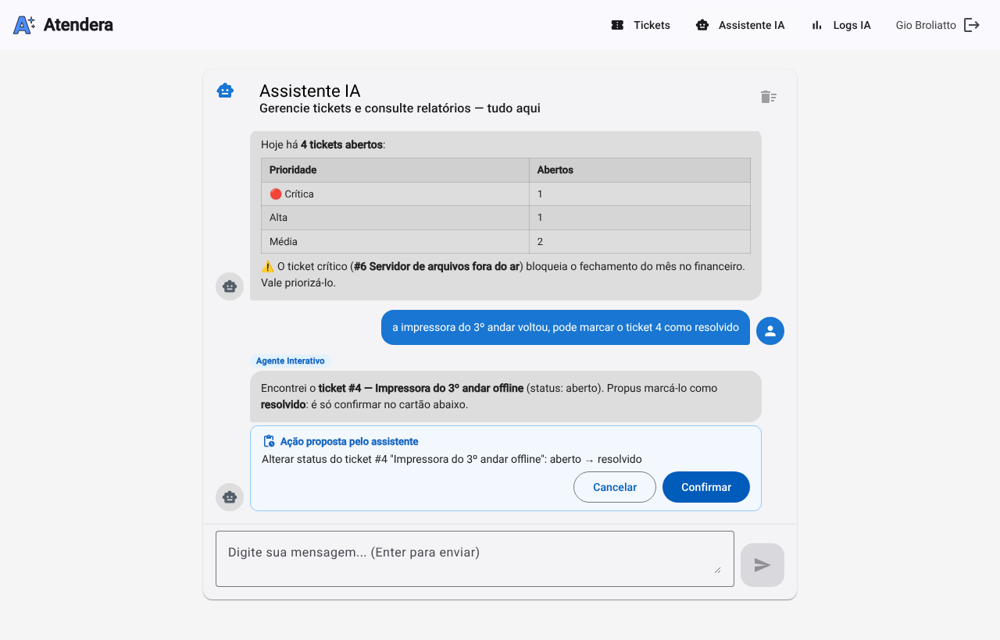
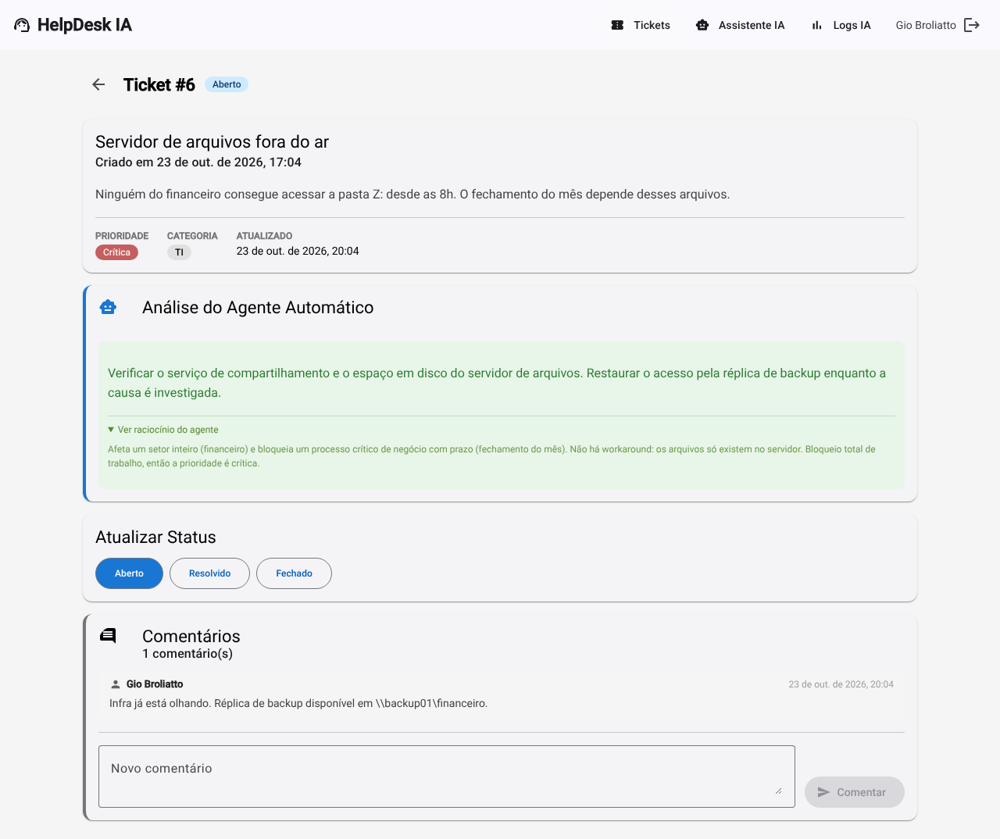
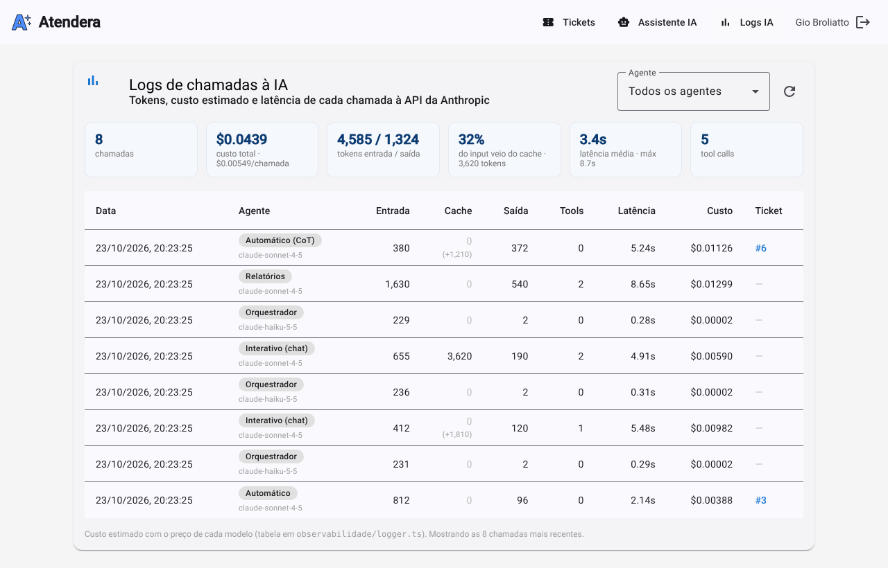
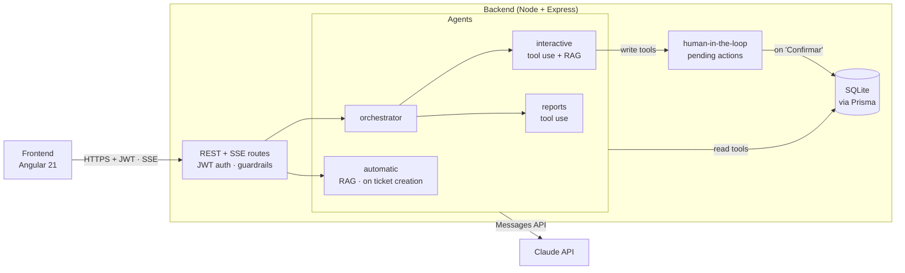

<div align="center">

# HelpDesk IA

**An internal help desk where AI agents triage tickets, answer questions about them and act on them, with a human confirming every change.**


</div>

**English** · [Português](README.pt-BR.md)

> [!NOTE]
> HelpDesk IA is a learning project: I built it to go hands-on with AI agents in a real full-stack application, one concept at a time (tool use, RAG, streaming, human-in-the-loop, multi-agent orchestration, guardrails and observability).
>
> It was built for a Brazilian team, so the UI, the prompts and the code comments are in Portuguese.



<sub>The chat: the assistant answers with live data and every change it wants to make waits for a click on "Confirmar". Tickets and replies in the screenshots are illustrative examples.</sub>

---

## What it does

- **Automatic triage.** When a ticket is created, an agent reads it, sets its priority and category and suggests a fix, using the company's knowledge base (RAG). An optional "detailed analysis" mode (chain of thought + few-shot) also stores the agent's reasoning for auditing.
- **A chat that knows the tickets.** Ask "which tickets are critical?" or "how many tickets came in this week?". An orchestrator routes each message to the right agent: the **interactive agent** (look up and change tickets) or the **reports agent** (analytics with tables and insights). Answers stream in token by token.
- **Changes need a human.** When you ask the chat to close a ticket, change a priority or add a comment, nothing happens until you click **Confirmar** on the card the assistant shows. This is enforced by the server, not by the prompt.
- **Observability.** Every call to the Claude API is logged with tokens, estimated cost, latency and tool calls, with a dashboard at `/logs`.
- **MCP server.** The same ticket tools are exposed through the Model Context Protocol, so VS Code Copilot, Claude Desktop or Cursor can query the help desk directly.

<table>
<tr>
<td width="50%" valign="top">

<sub>Ticket detail: the automatic agent's suggestion and, in detailed mode, its reasoning.</sub>
</td>
<td width="50%" valign="top">

<sub>The <code>/logs</code> dashboard: tokens, cost and latency of every call, filterable by agent.</sub>
</td>
</tr>
</table>

---

## Architecture



| Folder | What it is |
|---|---|
| [`helpdesk/backend/`](helpdesk/backend) | REST API in Node.js + Express + Prisma/SQLite: agents, tools, RAG, guardrails, human-in-the-loop, observability, auth and the MCP server. |
| [`helpdesk/frontend/`](helpdesk/frontend) | Angular 21 standalone app with Angular Material: ticket list and detail, chat, logs dashboard and login. |
| [`estudos/`](estudos) | Earlier study scripts (first API calls and the tool use loop), with notes in Portuguese. |
| [`docs/`](docs) | Screenshots and the [in-depth guide](docs/how-it-works.md) to how each piece works. |

---

## Technical highlights

### Four agents with clear jobs

| Agent | Trigger | What it does |
|---|---|---|
| **Automatic** ([`agenteAutomatico.ts`](helpdesk/backend/src/agents/agenteAutomatico.ts)) | A ticket is created | Classifies priority and category and suggests a solution. Returns JSON that is normalized and validated before it is saved. |
| **Interactive** ([`agenteInterativo.ts`](helpdesk/backend/src/agents/agenteInterativo.ts)) | Chat | Looks tickets up with tools, proposes changes and streams the answer. Keeps a short history (last 8 messages). |
| **Reports** ([`agenteRelatorios.ts`](helpdesk/backend/src/agents/agenteRelatorios.ts)) | Chat | Stateless analytics: volume per period, distribution, tickets with no updates (SLA risk). |
| **Orchestrator** ([`orquestrador.ts`](helpdesk/backend/src/agents/orquestrador.ts)) | Every chat message | A cheap classification call (`max_tokens: 10`) that routes to the interactive agent, the reports agent or both. |

Each agent keeps a small, focused system prompt instead of one prompt that tries to do everything.

### Tool use loop

The interactive and reports agents run the standard tool use loop: the model asks for one or more tools, the server runs them and sends back every `tool_result` in a single message, and the loop repeats until the model writes its final answer. Tool arguments are validated with Zod before touching the database, and a failing tool (an unknown ticket, for example) goes back to the model as `is_error: true` so it can explain the problem instead of the whole request failing.

### Human-in-the-loop enforced by the server

Asking the model to "always confirm first" is not a security boundary. Here, the write tools (`alterar_status`, `alterar_prioridade`, `adicionar_comentario`) **don't write anything**: they create a `AcaoPendente` row and the chat shows a card with **Confirmar / Cancelar**. Only `POST /acoes/:id/confirmar` runs the change. A "yes" typed in the chat, or a prompt injection, can't execute anything. The transition is atomic (a double click doesn't run it twice), proposals expire after 15 minutes and only the user who asked can confirm.

### RAG with local embeddings

Knowledge base articles are embedded locally with `Xenova/all-MiniLM-L6-v2` (384 dimensions, no API key needed) and stored in SQLite. Before calling Claude, the automatic and interactive agents embed the question, rank the articles by cosine similarity (top 3, threshold 0.35) and inject the matches into the prompt.

### Prompt engineering

- **Two triage modes.** Simple (~200 output tokens) by default, or chain of thought + four few-shot examples (~600 tokens) when the user asks for a detailed analysis. The reasoning is stored in `raciocinioIA` and shown on the ticket.
- **Fresh data over history.** The interactive agent is told never to answer about a ticket's state from the conversation history, only from a fresh tool call.

### Guardrails

- Every input that reaches a model goes through [`validarInput`](helpdesk/backend/src/guardrails/validarInput.ts): size limits and known prompt injection patterns are rejected before spending tokens.
- Ticket title and description are wrapped in XML tags (with `<` and `>` escaped) and treated as data by the automatic agent.
- The markdown rendered from model output goes through Angular's sanitizer, so HTML injected through a ticket can't become XSS in the chat.

### Streaming (SSE)

Chat answers are sent as Server-Sent Events while Claude generates them. The frontend reads them with `fetch` + `ReadableStream` (the route is a `POST`, which `EventSource` doesn't support), buffering partial lines between reads.

### Observability

[`logger.ts`](helpdesk/backend/src/observabilidade/logger.ts) records input/output tokens, estimated cost, latency, tool calls and the related ticket for every call, adding up all iterations of a tool use loop. The `/logs` page shows totals and a filterable table.

### Authentication

JWT login, passwords hashed with `scrypt` and a random salt, rate limiting on failed logins, and every route except `/health` and `/auth/login` protected. Chat history and pending actions belong to the user who created them, and comment authors come from the token, never from the request body.

### MCP server

[`src/mcp/server.ts`](helpdesk/backend/src/mcp/server.ts) exposes the ticket tools over stdio. [`.vscode/mcp.json`](.vscode/mcp.json) is already set up, so VS Code starts the server when you open the repository. Through MCP, confirming write actions is up to the host (VS Code asks before running each tool).

---

## Stack

| Layer | Technologies |
|---|---|
| Backend | Node.js 22, Express 5, Prisma 7 + SQLite (better-sqlite3 adapter), Zod, JWT, express-rate-limit |
| AI | Claude API (Anthropic SDK), MCP SDK, `@xenova/transformers` for local embeddings |
| Frontend | Angular 21 (standalone), Angular Material, RxJS, marked |
| Tests | Vitest (Angular unit-test builder) |

---

## Running locally

**Requirements:** Node.js 22+ and npm 11+ (Node 24 ships with it; on Node 22 run `npm install -g npm@11`). You'll need an [Anthropic API](https://console.anthropic.com) key.

### 1. Backend

```bash
cd helpdesk/backend
npm install
```

Create `helpdesk/backend/.env`:

```bash
ANTHROPIC_API_KEY=sk-ant-...
JWT_SECRET=...           # generate one with: openssl rand -base64 32
```

Then create the database, your user and the knowledge base:

```bash
npx prisma migrate dev                                   # creates prisma/helpdesk.db
npm run usuario:criar -- "Your Name" you@company.com your-password
node scripts/popular-base-conhecimento.js                # optional: RAG articles (downloads ~80 MB on first run)
npm run dev                                              # http://localhost:3000 (GET /health to check)
```

### 2. Frontend

```bash
cd helpdesk/frontend
npm install
npm start                # http://localhost:4200
```

Log in with the user you created. Create a ticket to see the automatic agent at work, then open **Assistente IA** to chat.

### 3. MCP server (optional)

Open the repository in VS Code: [`.vscode/mcp.json`](.vscode/mcp.json) starts the server for Copilot. To run it by hand:

```bash
cd helpdesk/backend
npx ts-node src/mcp/server.ts
```

### 4. Tests

```bash
cd helpdesk/frontend && npx ng test --watch=false
cd helpdesk/backend && npx tsc --noEmit
```

<details>
<summary><strong>Backend environment variables</strong></summary>

| Variable | Required | Description |
|---|---|---|
| `ANTHROPIC_API_KEY` | Yes | Anthropic API key |
| `JWT_SECRET` | Yes | Secret used to sign JWTs (`openssl rand -base64 32`). The server refuses to start without it. |
| `JWT_EXPIRES_IN` | No | Session length (default `8h`) |
| `PORT` | No | Server port (default `3000`) |
| `CORS_ORIGIN` | No | Allowed origins, comma-separated (default `http://localhost:4200`) |

</details>

<details>
<summary><strong>Backend scripts</strong></summary>

| Command | What it does |
|---|---|
| `npm run dev` | Starts the API with ts-node |
| `npm run build` / `npm start` | Compiles to `dist/` and runs the compiled build |
| `npm run db:migrate` | Applies Prisma migrations |
| `npm run db:studio` | Opens Prisma Studio |
| `npm run usuario:criar -- "Name" email password` | Creates a user (or resets their password) |
| `node scripts/popular-base-conhecimento.js` | Rebuilds the RAG knowledge base |
| `node scripts/limpar-chat.js` | Deletes every chat message |

</details>

<details>
<summary><strong>API</strong></summary>

All routes except the first two need `Authorization: Bearer <token>`.

| Method | Route | Description |
|---|---|---|
| `GET` | `/health` | Health check |
| `POST` | `/auth/login` | `{ email, senha }` → `{ token, usuario }` |
| `GET` | `/auth/me` | Logged-in user |
| `GET` | `/tickets` | List tickets |
| `GET` | `/tickets/:id` | Ticket with messages and comments |
| `POST` | `/tickets` | Create a ticket and trigger the automatic agent (`comRaciocinio: true` for detailed mode) |
| `PATCH` | `/tickets/:id` | Change the status |
| `POST` | `/tickets/:id/comentarios` | Add a comment |
| `POST` | `/orquestrador/stream` | Chat (SSE): routes to the right agent |
| `GET` / `DELETE` | `/chat/historico` | The user's chat history |
| `POST` | `/acoes/:id/confirmar` · `/acoes/:id/cancelar` | Resolve an action proposed in the chat |
| `GET` | `/logs` | Calls to the Claude API with totals (`?agente=` and `?limit=`) |

</details>

---

## Learn more

[`docs/how-it-works.md`](docs/how-it-works.md) walks through every concept in detail: the full ticket flow, the tool use loop, RAG and cosine similarity, SSE, human-in-the-loop, orchestration, guardrails, observability and MCP.

## License

Learning project, free to use for educational purposes.

## Author

**Giovani Broliatto**

[](https://www.linkedin.com/in/giobroliatto/)
