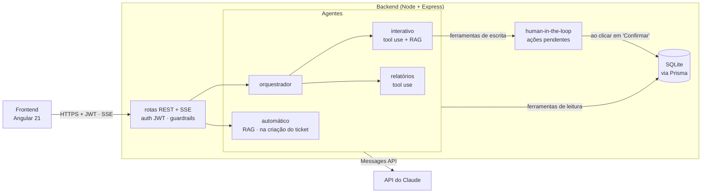

<div align="center">

# HelpDesk IA

**Um help desk interno em que agentes de IA fazem a triagem dos tickets, respondem perguntas sobre eles e agem sobre eles, com um humano confirmando cada alteração.**


</div>

[English](README.md) · **Português**

> [!NOTE]
> O HelpDesk IA é um projeto de aprendizado: construí para praticar agentes de IA numa aplicação full stack de verdade, um conceito por vez (tool use, RAG, streaming, human-in-the-loop, orquestração multi-agente, guardrails e observabilidade).
>
> Ele foi feito para uma equipe brasileira, então a interface, os prompts e os comentários do código estão em português.


<sub>O chat: o assistente responde com dados atualizados e toda alteração que ele quer fazer espera um clique em "Confirmar". Os tickets e respostas das imagens são exemplos ilustrativos.</sub>

---

## O que ele faz

- **Triagem automática.** Quando um ticket é criado, um agente lê o conteúdo, define prioridade e categoria e sugere uma solução usando a base de conhecimento da empresa (RAG). Um modo opcional de "análise detalhada" (chain of thought + few-shot) também guarda o raciocínio do agente para auditoria.
- **Um chat que conhece os tickets.** Pergunte "quais tickets estão críticos?" ou "quantos tickets entraram esta semana?". Um orquestrador encaminha cada mensagem ao agente certo: o **agente interativo** (consulta e altera tickets) ou o **agente de relatórios** (análises com tabelas e insights). As respostas chegam em streaming, token a token.
- **Alterações precisam de um humano.** Quando você pede ao chat para fechar um ticket, mudar uma prioridade ou adicionar um comentário, nada acontece até você clicar em **Confirmar** no cartão que o assistente mostra. Quem garante isso é o servidor, não o prompt.
- **Observabilidade.** Toda chamada à API do Claude é registrada com tokens, custo estimado, latência e tool calls, com um painel em `/logs`.
- **Servidor MCP.** As mesmas ferramentas de tickets são expostas pelo Model Context Protocol, então o VS Code Copilot, o Claude Desktop ou o Cursor conseguem consultar o help desk diretamente.

<table>
<tr>
<td width="50%" valign="top">

<sub>Detalhe do ticket: a sugestão do agente automático e, no modo detalhado, o raciocínio dele.</sub>
</td>
<td width="50%" valign="top">

<sub>O painel <code>/logs</code>: tokens, custo e latência de cada chamada, com filtro por agente.</sub>
</td>
</tr>
</table>

---

## Arquitetura



| Pasta | O que é |
|---|---|
| [`helpdesk/backend/`](helpdesk/backend) | API REST em Node.js + Express + Prisma/SQLite: agentes, ferramentas, RAG, guardrails, human-in-the-loop, observabilidade, autenticação e o servidor MCP. |
| [`helpdesk/frontend/`](helpdesk/frontend) | Aplicação Angular 21 standalone com Angular Material: lista e detalhe de tickets, chat, painel de logs e login. |
| [`estudos/`](estudos) | Scripts de estudo anteriores (primeiras chamadas à API e o loop de tool use), com anotações. |
| [`docs/`](docs) | Capturas de tela e o [guia detalhado](docs/como-funciona.md) de como cada parte funciona. |

---

## Destaques técnicos

### Quatro agentes com funções claras

| Agente | Quando roda | O que faz |
|---|---|---|
| **Automático** ([`agenteAutomatico.ts`](helpdesk/backend/src/agents/agenteAutomatico.ts)) | Um ticket é criado | Classifica prioridade e categoria e sugere uma solução. Devolve JSON que é normalizado e validado antes de ser salvo. |
| **Interativo** ([`agenteInterativo.ts`](helpdesk/backend/src/agents/agenteInterativo.ts)) | Chat | Consulta tickets com ferramentas, propõe alterações e responde em streaming. Mantém um histórico curto (últimas 8 mensagens). |
| **Relatórios** ([`agenteRelatorios.ts`](helpdesk/backend/src/agents/agenteRelatorios.ts)) | Chat | Análises sem estado: volume por período, distribuição, tickets sem atualização (risco de SLA). |
| **Orquestrador** ([`orquestrador.ts`](helpdesk/backend/src/agents/orquestrador.ts)) | Toda mensagem do chat | Uma chamada de classificação no Claude Haiku (`max_tokens: 10`, sem thinking) que encaminha para o agente interativo, o de relatórios ou os dois. Um modelo pequeno basta para escolher entre três palavras, por uma fração do preço e da latência do modelo principal. |

Cada agente tem um system prompt pequeno e focado, em vez de um prompt único que tenta fazer tudo.

### Loop de tool use

Os agentes interativo e de relatórios rodam o loop padrão de tool use: o modelo pede uma ou mais ferramentas, o servidor executa e devolve todos os `tool_result` numa única mensagem, e o loop se repete até o modelo escrever a resposta final. Os argumentos das ferramentas são validados com Zod antes de acessar o banco, e uma ferramenta que falha (um ticket inexistente, por exemplo) volta para o modelo como `is_error: true`, para que ele explique o problema em vez de a requisição inteira falhar.

### Human-in-the-loop garantido pelo servidor

Pedir ao modelo para "sempre confirmar antes" não é uma barreira de segurança. Aqui, as ferramentas de escrita (`alterar_status`, `alterar_prioridade`, `adicionar_comentario`) **não gravam nada**: elas criam uma linha em `AcaoPendente` e o chat mostra um cartão com **Confirmar / Cancelar**. Só o `POST /acoes/:id/confirmar` executa a alteração. Um "sim" digitado no chat, ou um prompt injection, não consegue executar nada. A transição é atômica (um clique duplo não executa duas vezes), as propostas expiram em 15 minutos e só o usuário que pediu pode confirmar.

### RAG com embeddings locais

Os artigos da base de conhecimento viram vetores localmente com `Xenova/all-MiniLM-L6-v2` (384 dimensões, sem precisar de API key) e ficam salvos no SQLite. Antes de chamar o Claude, os agentes automático e interativo transformam a pergunta em vetor, ordenam os artigos por similaridade de cosseno (top 3, limite de 0.35) e injetam os mais próximos no prompt.

### Prompt engineering

- **Dois modos de triagem.** Simples (~200 tokens de saída) por padrão, ou chain of thought + quatro exemplos few-shot (~600 tokens) quando o usuário pede uma análise detalhada. O raciocínio fica salvo em `raciocinioIA` e aparece no ticket.
- **Dados frescos em vez de histórico.** O agente interativo é instruído a nunca responder sobre o estado de um ticket a partir do histórico da conversa, só a partir de uma consulta nova às ferramentas.

### Guardrails

- Todo input que chega a um modelo passa pelo [`validarInput`](helpdesk/backend/src/guardrails/validarInput.ts): limites de tamanho e padrões conhecidos de prompt injection são recusados antes de gastar tokens.
- O título e a descrição do ticket vão dentro de tags XML (com `<` e `>` escapados) e são tratados como dados pelo agente automático.
- O markdown gerado a partir da resposta do modelo passa pelo sanitizador do Angular, então HTML injetado por um ticket não vira XSS no chat.

### Streaming (SSE)

As respostas do chat são enviadas como Server-Sent Events enquanto o Claude gera o texto. O frontend lê com `fetch` + `ReadableStream` (a rota é `POST`, que o `EventSource` não suporta), guardando num buffer as linhas que chegam pela metade entre um read e outro.

### Observabilidade

O [`logger.ts`](helpdesk/backend/src/observabilidade/logger.ts) registra o modelo, tokens de entrada e saída, custo estimado (pelo preço de cada modelo), latência, tool calls e o ticket relacionado de cada chamada, somando todas as iterações do loop de tool use. A página `/logs` mostra os totais e uma tabela com filtro.

### Autenticação

Login com JWT, senhas com hash `scrypt` e salt aleatório, rate limit nos logins com falha e todas as rotas protegidas, menos `/health` e `/auth/login`. O histórico do chat e as ações pendentes pertencem ao usuário que os criou, e o autor dos comentários vem do token, nunca do body da requisição.

### Servidor MCP

O [`src/mcp/server.ts`](helpdesk/backend/src/mcp/server.ts) expõe as ferramentas de tickets via stdio. O [`.vscode/mcp.json`](.vscode/mcp.json) já está configurado, então o VS Code inicia o servidor quando você abre o repositório. Pelo MCP, confirmar as ações de escrita fica a cargo do host (o VS Code pergunta antes de rodar cada ferramenta).

---

## Stack

| Camada | Tecnologias |
|---|---|
| Backend | Node.js 22, Express 5, Prisma 7 + SQLite (adapter do better-sqlite3), Zod, JWT, express-rate-limit |
| IA | API do Claude (Anthropic SDK), MCP SDK, `@xenova/transformers` para embeddings locais |
| Frontend | Angular 21 (standalone), Angular Material, RxJS, marked |
| Testes | Vitest (builder de testes unitários do Angular) |

---

## Como rodar localmente

**Requisitos:** Node.js 22+ e npm 11+ (o Node 24 já vem com ele; no Node 22, rode `npm install -g npm@11`). Você vai precisar de uma chave da [API da Anthropic](https://console.anthropic.com).

### 1. Backend

```bash
cd helpdesk/backend
npm install
```

```bash
cp .env.example .env     # preencha ANTHROPIC_API_KEY e JWT_SECRET
```

Depois crie o banco, o seu usuário e os dados de exemplo:

```bash
npx prisma migrate dev                                   # cria prisma/helpdesk.db
npm run usuario:criar -- "Seu Nome" voce@empresa.com sua-senha
npm run db:seed                                          # tickets de exemplo + base de conhecimento do RAG (baixa ~80 MB na primeira vez)
npm run dev                                              # http://localhost:3000 (GET /health para conferir)
```

Os tickets de exemplo vêm com análises escritas à mão, para as telas não começarem vazias. Crie um ticket novo para ver o agente automático de verdade.

### 2. Frontend

```bash
cd helpdesk/frontend
npm install
npm start                # http://localhost:4200
```

Entre com o usuário que você criou. Crie um ticket para ver o agente automático trabalhando e depois abra o **Assistente IA** para conversar.

### 3. Servidor MCP (opcional)

Abra o repositório no VS Code: o [`.vscode/mcp.json`](.vscode/mcp.json) inicia o servidor para o Copilot. Para rodar manualmente:

```bash
cd helpdesk/backend
npx ts-node src/mcp/server.ts
```

### 4. Testes

```bash
cd helpdesk/frontend && npx ng test --watch=false
cd helpdesk/backend && npx tsc --noEmit
```

<details>
<summary><strong>Variáveis de ambiente do backend</strong></summary>

| Variável | Obrigatória | Descrição |
|---|---|---|
| `ANTHROPIC_API_KEY` | Sim | Chave da API da Anthropic |
| `JWT_SECRET` | Sim | Segredo usado para assinar os JWTs (`openssl rand -base64 32`). O servidor não sobe sem ele. |
| `ANTHROPIC_MODEL` | Não | Modelo usado pelos agentes (padrão `claude-sonnet-4-5`) |
| `ANTHROPIC_MODEL_CLASSIFICADOR` | Não | Modelo do classificador do orquestrador (padrão `claude-haiku-5-5`) |
| `JWT_EXPIRES_IN` | Não | Duração da sessão (padrão `8h`) |
| `PORT` | Não | Porta do servidor (padrão `3000`) |
| `CORS_ORIGIN` | Não | Origens permitidas, separadas por vírgula (padrão `http://localhost:4200`) |

</details>

<details>
<summary><strong>Scripts do backend</strong></summary>

| Comando | O que faz |
|---|---|
| `npm run dev` | Sobe a API com ts-node |
| `npm run build` / `npm start` | Compila para `dist/` e roda a versão compilada |
| `npm run db:migrate` | Aplica as migrations do Prisma |
| `npm run db:studio` | Abre o Prisma Studio |
| `npm run usuario:criar -- "Nome" email senha` | Cria um usuário (ou redefine a senha) |
| `npm run db:seed` | Tickets de exemplo (só se não houver nenhum) e a base de conhecimento do RAG |
| `npm run kb:popular` | Recria a base de conhecimento do RAG |
| `node scripts/limpar-chat.js` | Apaga todas as mensagens do chat |

</details>

<details>
<summary><strong>API</strong></summary>

Todas as rotas, menos as duas primeiras, exigem `Authorization: Bearer <token>`.

| Método | Rota | Descrição |
|---|---|---|
| `GET` | `/health` | Health check |
| `POST` | `/auth/login` | `{ email, senha }` → `{ token, usuario }` |
| `GET` | `/auth/me` | Usuário logado |
| `GET` | `/tickets` | Lista os tickets |
| `GET` | `/tickets/:id` | Ticket com mensagens e comentários |
| `POST` | `/tickets` | Cria um ticket e dispara o agente automático (`comRaciocinio: true` para o modo detalhado) |
| `PATCH` | `/tickets/:id` | Altera o status |
| `POST` | `/tickets/:id/comentarios` | Adiciona um comentário |
| `POST` | `/orquestrador/stream` | Chat (SSE): encaminha para o agente certo |
| `GET` / `DELETE` | `/chat/historico` | Histórico do chat do usuário |
| `POST` | `/acoes/:id/confirmar` · `/acoes/:id/cancelar` | Resolve uma ação proposta no chat |
| `GET` | `/logs` | Chamadas à API do Claude com totais (`?agente=` e `?limit=`) |

</details>

---

## Saiba mais

O [`docs/como-funciona.md`](docs/como-funciona.md) explica cada conceito em detalhe: o fluxo completo do ticket, o loop de tool use, RAG e similaridade de cosseno, SSE, human-in-the-loop, orquestração, guardrails, observabilidade e MCP.

## Licença

Projeto de aprendizado, de uso livre para fins educacionais.

## Autor

**Giovani Broliatto**

[](https://www.linkedin.com/in/giobroliatto/)
